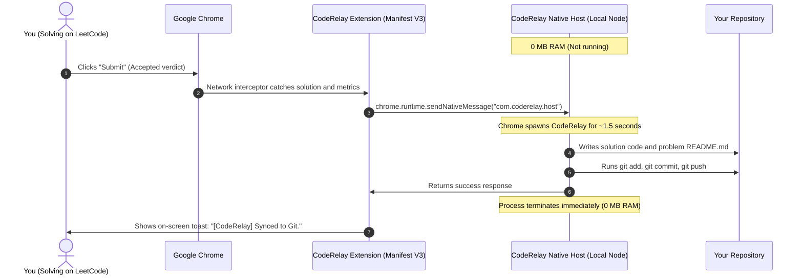

# CodeRelay

Capture accepted coding submissions from LeetCode and synchronize them directly to your personal Git repository. CodeRelay operates 100% locally with 0 MB idle RAM, 0 background processes, and zero third-party token authorization.

---

## Quick Setup (2 Minutes)

CodeRelay lives in its own folder and connects to your DSA repository (such as `DSA-Progress`). **Do not copy CodeRelay inside your DSA repository** - keep them as two separate folders.

### Step 1: Connect to your DSA repository
1. In File Explorer, locate your folder.
2. Hold **Shift** and **Right-click** on the folder, then select **"Copy as path"**.
3. In your terminal inside the `CodeRelay` directory, run:

```bash
node apps/cli/dist/index.js init "<PASTE_COPIED_PATH_HERE>"
```

*Example:*
```bash
node apps/cli/dist/index.js init "C:\Users\Username\Documents\Your-Folder"
```

CodeRelay automatically detects and uses your existing `LeetCode` and `Codeforces` etc folders inside that repository. None of your existing files will be touched.

### Step 2: Register Chrome Native Messaging
Run:

```bash
node apps/cli/dist/index.js register
```

This registers the local host in your Windows registry. Chrome will now launch CodeRelay on-demand only when you submit an accepted problem, and terminate it immediately after pushing.

### Step 3: Load the extension in Chrome
1. In Google Chrome, go to `chrome://extensions/`
2. Turn on **Developer mode** in the top-right corner.
3. Click **Load unpacked** and select:
   `<Path-To-CodeRelay>\apps\extension`
4. Click the CodeRelay extension icon in the toolbar. It will confirm:
   - **Mode:** Native Messaging (0 RAM, On-Demand)
   - **Target Repo:** Your configured path

**Setup is complete.** You can close your terminal and never touch it again. Every time you solve a problem on LeetCode, CodeRelay automatically captures, formats, commits, and pushes your solution to your repository.

---

## Why CodeRelay?

Tools like LeetHub require you to generate a GitHub Personal Access Token or OAuth grant with full read and write permissions to your entire GitHub account and send it through third-party browser extensions.

CodeRelay takes a local-first approach:

- **100% Local and Private:** Never asks for GitHub passwords or OAuth tokens. It uses your computer's existing Git configuration and credentials (SSH keys or Windows Git Credential Manager).
- **0 MB RAM and 0 Ports Idle:** Using Chrome Native Messaging, CodeRelay does not run a background daemon or keep any network port open. Chrome wakes up CodeRelay for approximately 1.5 seconds only when an accepted submission occurs, commits, pushes, and immediately exits.
- **Non-Intrusive:** Sits in its own directory and writes to your designated solutions repository. You configure it once, and no terminal interaction is needed afterwards.
- **Clean Documentation:** Automatically creates problem directories with solution code and a Markdown file containing the problem description, difficulty badge, tags, and runtime and memory performance statistics.

---

## How It Works



---

## Repository Organization

CodeRelay automatically maps solutions into tag-based folders inside your repository:

```text
DSA-Progress/
├── LeetCode/
│   ├── Array/
│   │   └── 0001-two-sum/
│   │       ├── solution.py          (Your accepted code)
│   │       └── README.md            (Problem statement and stats)
│   ├── Two Pointers/
│   │   └── 0015-3sum/
│   │       ├── solution.cpp
│   │       └── README.md
│   ├── Stack/
│   │   └── 0020-valid-parentheses/
│   │       ├── solution.py
│   │       └── README.md
│   ├── General/                     (Fallback when tags cannot be fetched)
│   └── ...
└── Codeforces/
```

### Generated Problem Documentation Example

```markdown
# 1. Two Sum

**Difficulty:** Easy  
**Problem Link:** [https://leetcode.com/problems/two-sum/](https://leetcode.com/problems/two-sum/)


## Submission Stats

| Metric | Value | Percentile |
| :--- | :--- | :--- |
| **Language** | `python3` | - |
| **Runtime** | 35 ms | Beats 92.4% |
| **Memory** | 16.5 MB | Beats 84.1% |

### Tags
`Array` `Hash Table`

## Problem Description
Given an array of integers nums and an integer target, return indices of the two numbers such that they add up to target...
```

---

## CLI Reference

All commands are run from the `CodeRelay` directory:

```bash
# Connect to your solutions repository
node apps/cli/dist/index.js init "<path>"

# Register Chrome Native Messaging (Recommended: 0 RAM, on-demand execution)
node apps/cli/dist/index.js register

# Remove Chrome Native Messaging registration
node apps/cli/dist/index.js unregister

# Check configuration and Git repository status
node apps/cli/dist/index.js status

# (Optional) Run manual local HTTP receiver server
node apps/cli/dist/index.js start [--port 45678]

# (Optional) Enable or disable silent Windows startup daemon
node apps/cli/dist/index.js autostart [enable|disable]
```

---

## Monorepo Architecture

```text
CodeRelay/
│
├── apps/
│   ├── extension/              # Manifest V3 Chrome Extension
│   │   ├── src/interceptor.js  # MAIN world network hook (window.fetch)
│   │   ├── src/content.js      # On-screen notifications and DOM enrichment
│   │   ├── src/background.js   # Native messaging and HTTP bridge
│   │   └── popup/              # Dashboard UI
│   │
│   └── cli/                    # Command-line interface and Native Host
│       ├── src/native-host.ts  # Chrome Native Messaging stdio handler
│       ├── src/register-host.ts# Windows registry installer
│       └── src/index.ts        # CLI runner
│
├── packages/
│   ├── shared/                 # Common interfaces, language mappings
│   ├── platform-adapters/
│   │   └── leetcode/           # LeetCode normalization adapter
│   ├── git/                    # Git operations, README generator, duplicate detection
│   └── core/                   # Submission processing engine and local HTTP server
│
├── package.json
└── tsconfig.base.json
```

---

## Development and Testing

```bash
# Install dependencies
npm install

# Build all packages
npm run build

# Run TypeScript typechecks
npm run typecheck

# Run test suite
npm test
```

---

## License

MIT
